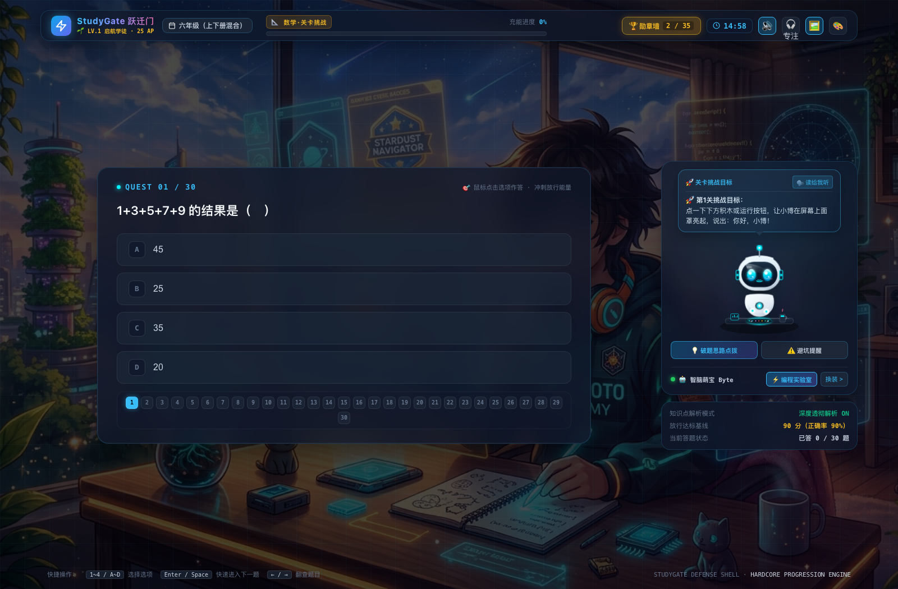
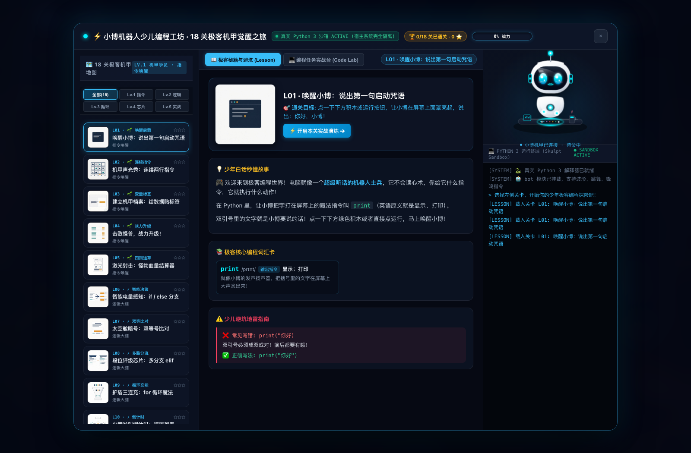
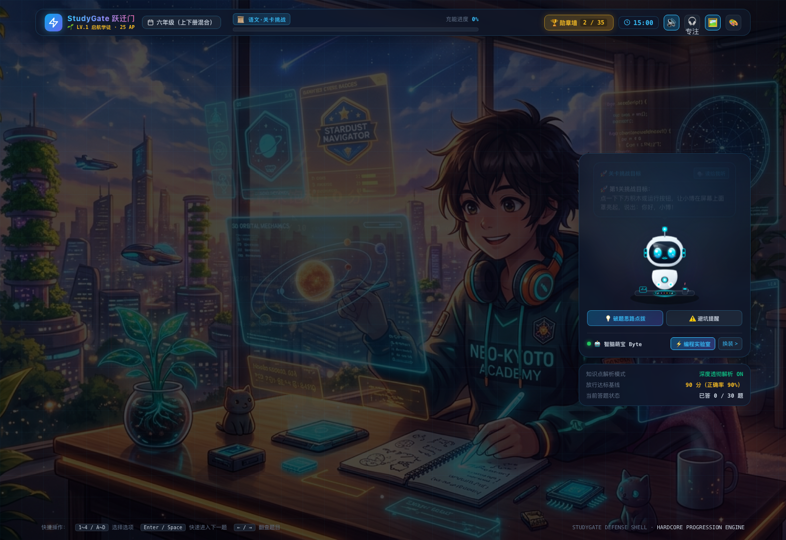
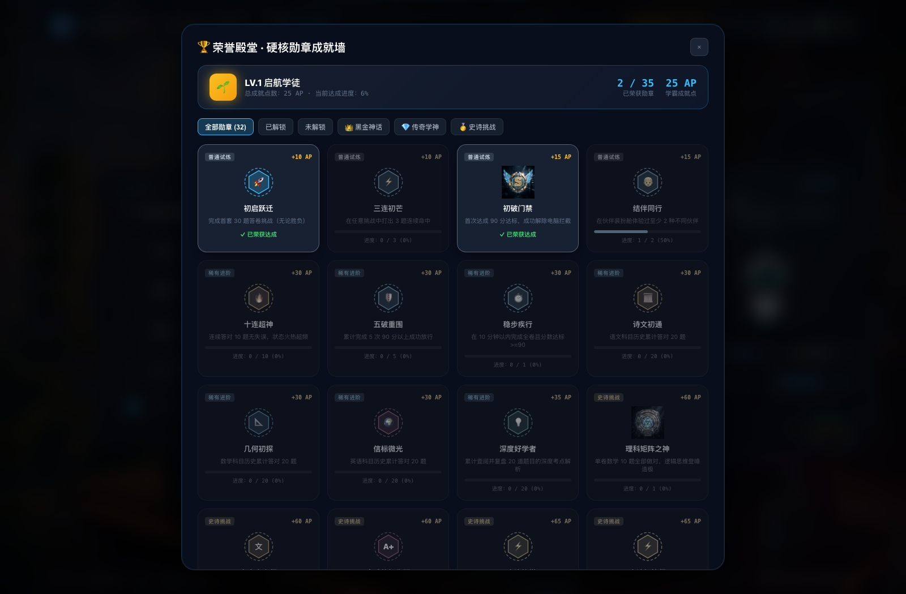
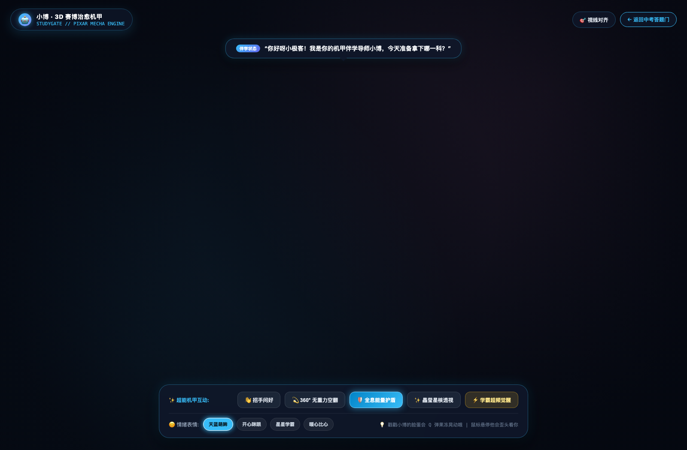
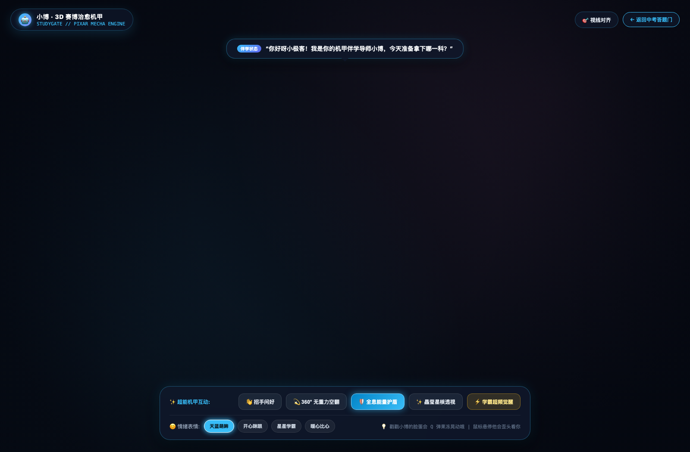

# 🚀 StudyGate · 少年极客能量跃迁门 (Windows 学习守门人)

> **“开机第一件事是答题，做不满 90 分不给进桌面！”**  
> 专为 10~17 岁初中少年打造的硬核学习自律、防沉迷与趣味机甲编程跃迁门。

<div align="center">

[](LICENSE)
[](README.md#-开源使用声明随便用保留作者署名即可)
[](https://github.com/9499758-wq)
[](https://microsoft.com)
[](https://dotnet.microsoft.com)
[](https://python.org)

<br/>



<p><em>▲ StudyGate 主答题台实机全景：3D 拟真伴学小博实时注视、母语外教三档变速、8Hz 阿尔法脑波专注白噪音</em></p>

</div>

---

## 📢 开源使用声明：随便用！保留作者署名即可！

> 🌟 **一句话核心授权原则：**  
> **本项目 100% 免费开源，随便用！完全自由！**  
> 无论是家里管娃督学、中小学校/少儿培训机构微机室批量装机、给亲戚朋友电脑部署，还是独立开发者二次开发、修改界面美化、深度魔改定制，甚至商业项目集成，**全都可以随意使用，无任何限制、无任何暗门、无任何隐形收费**。  
> 📌 **唯一要求：请在关于界面、代码注释或项目说明中保留原作者署名（`Author: 9499758-wq / StudyGate`）即可！** 感谢你对开源原创的尊重与支持！

---

## 📖 写在前面 · 深度讲透：这到底是个什么东西？

### 1. 传统家庭教育的“死循环”与真实痛点
家里有 10~17 岁（小学高年级到初中阶段）孩子的家长，几乎每天都在经历让人心力交瘁的拉锯战：
- **开机即沦陷**：孩子一回到家，电脑开机第一秒鼠标下意识双击游戏、直播或短视频图标；
- **猫鼠斗游戏**：家长一进书房查岗，孩子手忙脚乱狂按 `Alt+Tab` 切屏掩饰；
- **催促变怨气**：父母天天在耳边唠叨“先写作业再玩”、“只能玩半小时”，最后催出严重的逆反心理与亲子争吵；
- **防沉迷软件全面失效**：市面上的传统“家长控制软件”大多是花拳绣腿——初中生比大人想象的懂得多，任务管理器直接强杀、进安全模式删除、拔网线绕过，甚至粗暴扣下键盘；
- **居高临下的规训感**：传统工具界面粗糙冰冷，充斥着“我是家长，我来监视你”的囚徒感，孩子发自内心厌恶抵触。

### 2. StudyGate 的破局哲学：从“家长逼着学”到“凭学霸本事通关电脑”
StudyGate **彻底放弃了居高临下的监视思维，而是从教育心理学和人机交互底层重构了规则**：

1. 🎮 **把电脑开机权变成硬核通关游戏的战利品**  
   开机没有繁琐的讨价还价，密码从不藏着掖着。“儿子，你想玩游戏看B站？完全支持！只要开机凭你自己的本事，在 30 道初中真题里拿下 90 分，今天的电脑完全是你光明正大赢来的，玩得理直气壮，谁也挑不出刺！”
2. 🏆 **极客荣誉感与正向反馈拉满**  
   满分通关后，系统绝不冷冰冰退出，而是伴随 60FPS 粒子礼花与震撼电竞通关音效，弹出专属学霸战报生成器。一键生成带霸气文案的高清海报（“*今天电脑完全凭实力解锁！谁还敢说我玩电脑不务正业？😎*”），孩子甚至会主动截图发家庭群和朋友圈，自律的种子在成就感中生根发芽。
3. ⚡ **从“玩游戏的人”蜕变为“写代码的创作者”**  
   做题累了想换脑子？直接点进内置的【少儿机甲 Python 实验室】。零键盘敲打门槛，点积木即可编写纯正的 Python 代码，亲手操纵小博机甲发射离子光束，不知不觉掌握条件分支、for 循环、列表、字典与函数。“原来操纵程序，比单纯玩别人做的游戏帅气一百倍！”

---

## 📸 核心系统实机高清全景解析（绝不敷衍，图文全览）

### 🌟 系统一：🛡️ 极客物理门禁与主答题台 (StudyGate Hero Core)

<div align="center">
  
</div>

- **🤖 3D 拟真萌宠“小博”AI 伴学导师**：
  - 基于 Pixar 动画质感渲染，鹅卵石白瓷流线机身与磁悬浮分体设计；
  - **眼神微注视追踪**：曲面黑晶面罩内的天蓝色水汪汪大眼睛随鼠标自然转动，栩栩如生；
  - **多维动态情绪反应**：思考时微转天线、答对时开心庆祝（celebrate）、点拔时化身名师讲课（lecture）；
  - **大白话破题思路点拨**：遇到难题轻点小博，立即给出通俗易懂的思维拆解模型，绝不生硬剧透答案。
- **🎙️ 外教母语原声三档变速（拒绝冷冰冰的机械机器人音）**：
  - 常驻 **`⚡ 1.0x`** 语速切换胶囊按钮；
  - `🐢 0.8x 慢读磨耳朵`：音标与连读清澈如水，初学者听力精听神级助手；
  - `⚡ 1.0x 标准原声`：标准母语日常对话语速；
  - `🐇 1.2x 极速特训`：挑战中考真题听力提速磨耳朵；
  - 深度直调有道录音棚母语外教 MP3 库与高保真外教流，离线状态无缝自动降级为系统原生 TTS。
- **🎧 赛博专注心流波 / 极客白噪音 (Cyber Focus Flow)**：
  - 右上角 HUD 常驻一键开启 **`🎧 专注`**；
  - 纯原生 Web Audio API **离线物理实时合成**（无需下载任何大音频文件）：
    - 8Hz 舒曼共振双耳阿尔法节拍 + 320Hz 低通声学阻尼粉红白噪音；
    - 配备 1.0 秒平滑增益淡入淡出（绝不爆音），模拟星际飞船静音舱氛围，一秒屏蔽外界电视与杂音；
    - 首次开启立即加冕专属勋章：🏅 **【🎧 赛博心流·极客专注】**。
- **🛡️ 物理级防逃逸学习门禁**：
  - Windows 底层 `Winlogon\Shell` 优先接管，做不满 90 分不拉起 `explorer.exe` 桌面与任务栏；
  - 全局底层 API 钩子全面阻断 `Win` 键、`Alt+Tab`、`Alt+F4`、`F1~F12`、任务管理器与切屏组合键；
  - 预设家长隐秘特权口令：`2184863`（按 `Ctrl+A` 呼出暗门终端，秒级放行）。

---

### 🌟 系统二：🐍 少儿机甲 Python 编程实验室 (Robo Python Arena)

<div align="center">
  
</div>

- **⚡ 顶部【机甲核心能级充能战力柱】**：
  - 实时反映 18 关攻克战力（`0% ~ 100%` 动态流光充能）；
  - 每通过一关，双目面罩绽放等离子流光，能量柱平滑暴涨，带给孩子亲手编写代码唤醒真实机甲的无上成就感！
- **🧩 零键盘打字门槛 · 积木速拼模式**：
  - 专为初学孩子设计：提供可视化积木方块，轻轻一点自动拼入代码行；
  - 独创 **【🪄 召唤小博一键拼装】**：遇到语法卡点点一下，小博瞬间演示标准写法；
  - 提供冒号 `:`、双引号 `""`、缩进 `Tab`、括号 `()` 等极客专用按键栏，彻底告别中英文标点错乱的噩梦。
- **📈 18 阶递进式机甲指令闯关体系**：
  - `L01` 唤醒小博：说出第一句启动咒语 (`print`)
  - `L02` 机甲声光秀：多行有序指令
  - `L03` 建立机甲档案：给数据贴标签 (变量)
  - `L04` 击败怪兽，战力升级！(自增运算)
  - `L05` 激光射击：怪兽血量结算器 (四则运算)
  - `L06` 智能电量感知：`if / else` 智能分支决策
  - `L07` 太空舱暗号：双等号 `==` 条件比对
  - `L08` 段位评级芯片：多分支 `elif`
  - `L09` 护盾三连充：`for i in range(3)` 循环魔法
  - `L10` 火箭发射倒计时：列表遍历与逐秒发射
  - `L11` 存钱罐魔法：1 加到 5 的循环累加器
  - `L12` 战术背包索引：列表门牌号 `bag[0]`
  - `L13` 拾取极品神装：`bag.append()` 动态装备装配
  - `L14` 巡检所有装备：`for item in bag` 遍历检索
  - `L15` 机甲核心参数卡：键值对字典 `bot["hp"]`
  - `L16` 一键战术宏：`def` 自定义函数封装与调用
  - `L17` 合体必杀技：带参数的高能大招函数
  - `L18` 机甲极客毕业礼：综合全息机甲防御战
- **💻 100% 离线纯前端判题沙箱**：
  - 单文件纯 JavaScript 实现语法树解析与沙箱环境，本地电脑**无需预先配置 Python 环境**，开箱即学即跑！

---

### 🌟 系统三：⚔️ 错题专项歼灭复仇模式 (Mistake Revenge)

<div align="center">
  
</div>

- **知耻而后勇的心理学闭环**：
  - 孩子最怕什么？答完 30 题考了 80 分，系统粗暴提示“不及格，再重新抽 30 题重来一遍”，这会造成极大的心理挫败与抵触！
  - StudyGate 独家设计**【错题专项歼灭复仇模式】**：当有错题时，操作区闪烁醒目的烈焰橙红流光按钮：**`⚔️ 专项歼灭本次错题 (N 道)`**；
- **靶向精准消灭错因**：
  - 点击后，系统自动抽取刚才失误的错题生成专属靶向小卷；
  - 萌宠小博化身严肃热血教官：*“知耻而后勇！把刚才跌倒的难关全部拿下！”*；
  - 只要将本次错题全部彻底攻克，当场判定**满分通关放行**，并在全屏礼花中加冕史诗级勋章：🏅 **【⚔️ 绝境反击·错题粉碎者】**（奖励 +65 AP）！

---

### 🌟 系统四：🏆 32 枚分级成就勋章与荣誉殿堂 (Cyber Badge Hall)

<div align="center">
  
</div>

- **全套 3D 机甲电竞风勋章**：
  - 🥇 **S-Rank 极客王者**：满分通关最高荣誉象征；
  - 📐 **理科矩阵之神**：数学满分、逻辑算力登峰造极；
  - 📜 **文言大宗师**：国风科幻卷轴，语文古诗文全通；
  - ⚔️ **绝境反击·错题粉碎者**：逆风翻盘、清剿错题专属史诗荣誉；
  - 🎧 **赛博心流·极客专注**：开启 8Hz 脑波静音舱沉浸学习；
- **AP 战力经验值与段位成长**：
  - 连击、答题、复仇均可累积 AP，解锁从新手学员到神级机甲极客的荣誉跃迁；
- **Canvas 离线海报生成器**：
  - 纯原生 Canvas 离线 60FPS 渲染，一键下载超清 PNG 图片，并自动将霸气打卡文案写入系统剪贴板。

---

### 🌟 系统五：🤖 3D 赛博超萌机甲小博 · 治愈伴学生命体 (Pixar Edition)

> 💡 **告别冰冷吓人的骨架拆解，为孩子打造真正温暖、治愈且酷炫的 3D 机甲伴学导师！**  
> 融合**苹果微晶白瓷美学 + 迪士尼/皮克斯圆润流线 + 灵动眼神表情系统 + Q 弹果冻微动力学**，纯前端纯原生打造可 360° 交互的实体机甲伴学核心！

<div align="center">
  
  
  <p><em>▲ 左：天蓝色灵动大眼睛·全息六边形护盾日常态 ｜ 右：学霸超频金色星星眼·全息觉醒态</em></p>
</div>

- **🧸 极度治愈的少儿美学设计（绝不吓到孩子）**：
  - **白瓷圆润微晶机身**：类似 EVE / 大白般的超光滑无棱角造型，温润如玉；
  - **曲面深邃星空面罩**：内嵌灵动水汪汪发光大眼睛，带双重晶莹高光点与粉色柔光腮红；
  - **4 种表情无缝切换**：天蓝萌眸（正常）、开心月牙眯眯眼（答对）、星星眼（学霸觉醒）、暖心爱心眼（陪伴）；
  - **自然眨眼与歪头萌杀**：鼠标在屏幕上滑动，小博会好奇地转头并微微偏头注视，活灵活现！
- **💫 酷炫超能互动与 Q 弹果冻微动力学**：
  - **果冻捏脸弹性反馈**：鼠标点击小博身体任意处，机身触发 Squash & Stretch 果冻弹性回弹与水滴泡泡治愈音效；
  - **360° 无重力空翻特技**：一键触发反重力空中翻滚特技，动作流畅丝滑；
  - **全息蜂巢能量护盾**：周身展开六边形半透明赛博能量盾，阻隔外界杂音干扰；
  - **晶莹星核透视**：一键让外壳化作晶莹琉璃冰晶，显露出身体深处跳动的星辰微光能量水晶，梦幻唯美；
- **🎵 纯原生 Web Audio 治愈系合成音效**：
  - 气泡水滴音、星光双音和弦，陪伴孩子轻松攻克中考难题。

---

## 🛠️ 项目工程结构

```
StudyGate/
├── demo/                  # 跨平台纯前端 Web 完整版 (随时随地直接打开可用，单文件零依赖)
│   ├── index.html         # 核心单页应用 (内置 1090 真题库、3D 伴学萌宠、Python 实验室、勋章墙)
│   ├── mecha-3d.html      # ⚡ 3D 赛博机甲伴学生命体·全息爆炸解构独立展厅 (Three.js 纯原生打造)
│   ├── app.html           # 源码工程模板
│   └── assets/            # 离线 3D 引擎库 (three.min.js, OrbitControls.js)、3D 勋章原画、极客深空壁纸
│       ├── three.min.js   # 100% 本地离线 Three.js 核心库
│       └── OrbitControls.js # 100% 本地离线轨道控制器
├── docs/                  # 规格说明书与完整技术图文资料
│   ├── screenshots/       # 4K / Retina 实机运行高清截图
│   │   ├── 01-studygate-main-hero.png
│   │   ├── 02-studygate-pylab-arena.png
│   │   ├── 03-studygate-badgewall-hall.png
│   │   ├── 04-studygate-revenge-portal.png
│   │   ├── 05-studygate-mecha-3d-assembled.png
│   │   └── 06-studygate-mecha-3d-overclock.png
│   ├── SPEC.md            # 系统总体技术规格书
│   ├── CONTRACTS.md       # 模块间调用契约与通信协议
│   ├── RISKS.md           # 风险管理矩阵与逃逸防护方案
│   └── ESCAPE.md          # 物理级安全阀与回滚兜底指引
├── src/                   # Windows 原生客户端源码 (.NET 8 WPF)
│   ├── Core/              # 跨平台判分内核、口令保险库、状态机
│   ├── App/               # Winlogon Shell 注册、底层输入钩子、看门狗互保
│   └── Ui/                # 沉浸式桌面客户端视图
├── data/
│   └── bank/              # 24 份语数英初中真题 JSON 原始题库
├── scripts/               # Windows 一键安全安装、卸载回滚 PowerShell 脚本
│   ├── install.ps1        # 管理员一键安装与注册开机引导
│   └── uninstall.ps1      # 物理级一键安全卸载（还原系统原生桌面）
└── tools/                 # 自动化测试与判题闭环核查脚本
```
│   └── Ui/                # 沉浸式桌面客户端视图
├── data/
│   └── bank/              # 24 份语数英初中真题 JSON 原始题库
├── scripts/               # Windows 一键安全安装、卸载回滚 PowerShell 脚本
│   ├── install.ps1        # 管理员一键安装与注册开机引导
│   └── uninstall.ps1      # 物理级一键安全卸载（还原系统原生桌面）
└── tools/                 # 自动化测试与判题闭环核查脚本
```

---

## 🚀 极速上手与全平台使用指南

### 方式 A：体验 Web 完整演示版 (macOS / Windows / Linux 浏览器秒开)

本系统采用纯前端单文件技术，**无需 Node.js、无需构建环境、无需安装数据库**，下载即可直接在本地浏览器跑起来：

```bash
# 1. 克隆代码仓库
git clone https://github.com/9499758-wq/StudyGate.git
cd StudyGate

# 2. 启动本地轻量 HTTP 服务 (Python 内置)
python3 -m http.server 8788 --directory demo/

# 3. 浏览器访问主界面：
http://127.0.0.1:8788/index.html
```

#### 💡 演示与直达 URL 参数（支持开机快捷方式）：
- **主答题与伴学界面**：`http://127.0.0.1:8788/index.html`
- **一键直达少儿 Python 实验室**：`http://127.0.0.1:8788/index.html?open=pylab`
- **一键直达勋章荣誉殿堂**：`http://127.0.0.1:8788/index.html?open=badgewall`
- **一键预览错题复仇结算台**：`http://127.0.0.1:8788/index.html?open=revenge-demo`
- **⚡ 3D 赛博超萌机甲小博 (Pixar Edition 互动空间)**：`http://127.0.0.1:8788/mecha-3d.html`
- **一键直达学霸超频觉醒态**：`http://127.0.0.1:8788/mecha-3d.html?overclock=true`

---

### 方式 B：Windows 原生开机门禁部署 (需要 Windows 10 / 11)

需要 .NET 8 SDK 编译环境。

1. **编译发布**：
   ```powershell
   dotnet build -c Release
   ```
2. **管理员一键装机**：
   ```powershell
   # 以管理员身份打开 PowerShell
   .\scripts\install.ps1
   ```
   > 脚本将自动设置安全管理员口令、备份现有系统 Shell、注册计划任务与 Winlogon 开机引导。重启后开机即进答题门。

3. **安全阀优先 · 一键卸载与安全回滚**：
   ```powershell
   # 随时可恢复系统原生桌面（不需要密码）
   .\scripts\uninstall.ps1
   ```

---

## 🛡️ 安全底线与防变砖安全阀（电脑绝不变砖承诺）

做学习门禁软件，家长最担心的是“系统搞崩了、变砖了、进不去系统了”。  
StudyGate 确立了**安全阀高于一切**的原则：

1. **物理级快速恢复**：`scripts\uninstall.ps1` 在任何时刻通过安全模式、Windows RE 恢复环境或管理员命令行均可直接执行，1 秒将 Windows Shell 还原为原生 `explorer.exe`；
2. **紧急管理员口令通道**：无论界面处于何种锁定状态，在键盘上按下 `Ctrl+A`（或快速连击左上角 Logo），输入紧急预设口令 `2184863`（安装时可自定义修改），主进程立即秒级放行并恢复桌面；
3. **100% 纯本地离线隐私**：所有做题记录、答卷数据、Python 代码均保存在本地浏览器 `localStorage` 中，绝不上报任何外部服务器，坚决捍卫家庭隐私。

---

## 📄 开源许可证与署名规则

本项目采用 [MIT 许可证](LICENSE) 全量开源。

```
MIT License
Copyright (c) 2026 StudyGate Contributors (Author: 9499758-wq)
```

**【重申授权准则】**：
- ✅ **随便用、随便改、随便部署、随便二开！**
- ✅ **个人使用、家庭督学、学校机房教学、商业项目集成完全无限制！**
- 📌 **唯一要求：请在软件说明、代码或关于界面中，保留原作者署名（`Author: 9499758-wq / StudyGate`）即可！**

欢迎各位极客老爸、老师与开发者提交 Issue、Pull Request，共同为下一代打造更加纯粹、有趣、硬核的自律与编程探索世界！🌟
